  

  

  
  
  

<h2 align="center">About Me</h2>

  I turn messy, repetitive processes into reliable systems. 
  My work sits where <b>AI meets engineering</b>.

<table>
  <tr>
    <td width="33%" valign="top">
      <h3 align="center">🧠 RAG &amp; Agents</h3>
      
Retrieval pipelines, knowledge-base chatbots and agent workflows built for real use, not just demos.

    </td>
    <td width="33%" valign="top">
      <h3 align="center">⚙️ Automation</h3>
      
n8n orchestration, content and media pipelines, and tooling that removes daily friction.

    </td>
    <td width="33%" valign="top">
      <h3 align="center">🖥️ Frontend</h3>
      
React interfaces and portfolio-grade sites, designed with taste and shipped fast.

    </td>
  </tr>
</table>

  <code>Product thinking</code> &nbsp;·&nbsp; <code>Design taste</code> &nbsp;·&nbsp; <code>Reliable systems</code> &nbsp;·&nbsp; <code>Fast iteration</code>

<h2 align="center">Tech Stack</h2>

  

  
  
  
  

<h2 align="center">Featured Projects</h2>

<table align="center">
  <tr>
    <td align="center">
      
    </td>
    <td align="center">
      
    </td>
  </tr>
  <tr>
    <td align="center">
      
    </td>
    <td align="center">
      
    </td>
  </tr>
</table>

<h2 align="center">GitHub Snapshot</h2>

  
  

  

<h2 align="center">How I Work</h2>

  <b>Ship a real first version</b>, then refine it with taste. 
  <b>Keep interfaces quiet, useful and fast.</b> 
  <b>Readable code over clever code.</b> 
  <b>Design for the person using the product</b>, not the screenshot.

<h2 align="center">Let's Connect</h2>

  Open to roles and collaborations in AI, automation and backend engineering, 
  as well as product ideas and engineering conversations.

  
  

  Built with care, clarity, and a little obsession over details.

